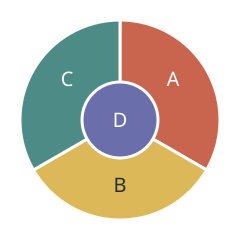

# 四色图志 Fourfold Atlas 完整实现方案

> 状态：完整实现方案，尚未实现或发布。
> 日期：2026-10-12 · 设计版本：1.1 · 名称为工作名。

本游戏在独立仓库 `mingzhangyang/four-colors` 中开发、测试和部署，games 仅提供目录入口。下文代码路径均相对于该独立仓库，不属于 games/src/games。详细方案副本已加入该仓库的 `docs/implementation-plan.md`。

共同方向、外链接入、交付批次和数学来源见 [两款图论游戏交付方案](proposal-graph-puzzles-delivery.md)。详细方案当前见 [four-colors 文档 PR #1](https://github.com/mingzhangyang/four-colors/pull/1)；该 PR 合并后，`four-colors/main/docs/implementation-plan.md` 将成为规范副本。

## 1 产品定位与第一分钟

**一句话：**用四种颜色修复一部失色地图册，在相邻区域之间寻找协调的秩序。

打开时直接看见一本摊开的地图册。第一页只有四块大区域，底部四枚颜料印章。轻点颜色，再点空白区域，颜料以短暂纸纤维扩散效果铺开；相邻同色时只在冲突边界出现可辨认的纹路。完成后，屋顶、田野或小船在地图中显现，页面角落盖上一枚完成印章。玩家此时已经学会规则，无需先阅读教程弹窗。

普通关目标体验为 2—6 分钟，入门关更短；后期精选关允许 6—10 分钟。每关应有一个主要观察点和一次值得记住的重排。正式首发目标为 **32 个主线关＋8 个短篇挑战＋每日地图＋自由配色收藏**。

## 2 核心规则与模式边界

- 所有需要填色的区域都是连通的平面区域；两块区域共享非零长度的边界才相邻，仅角点接触不算。
- 普通关使用不超过四种颜色；不要求四种全部用上。未着色区域不参与颜色冲突，但未填满不能完成。
- 固定颜色由小印章明确标记，不能改动。美术中的水面若只是背景，不参与填色，必须在图例中明确；若是可填区域，则与其他区域遵守同一规则。
- 一般填色允许暂时冲突，状态立即显示“有 2 处相邻同色”等具体反馈。玩家可以继续重排或撤销，不弹失败窗口。
- 通关只判断填满、无相邻冲突、固定线索满足及本关附加目标，不与某一份标准配色逐格比对。

| 模式 | 目标 | 允许动作 | 记录 |
| --- | --- | --- | --- |
| 图志主线 | 完成地图约束 | 填色、擦除、撤销；后期开放双色交换 | 完成与使用过提示的状态分别保存 |
| 修复短篇 | 用限定工具完成指定修复 | 由关卡明示；其中 4 关为仅双色交换，4 关为已验证的少色挑战 | 独立挑战印章，不阻塞主线 |
| 每日地图 | 完成当日统一地图 | 与普通规则一致，允许提示和撤销 | 当日完成、是否辅助、地图版本 |
| 收藏配色 | 重配已完成地图并导出作品 | 自由改色、切换纹理；无新通关奖励 | 收藏当前配色，不覆盖首次解题记录 |

全局映射调色盘只是换视觉皮肤，逻辑颜色始终为 0—3。玩家不能通过选出肉眼近似的两个颜色绕过判定；色觉辅助符号随逻辑颜色稳定对应。

## 3 标志机制 双色交换

当玩家发现一块区域被堵住，通常会逐块试着改色。进阶章节提供“双色交换”：选两种颜色，再点其中一块区域，所有仅通过这两色区域相连的完整片区一同浮起；确认后，两色互换。

它给玩家一个清晰的顿悟：**不是只盯着最后一块，而是重新安排一整片关系。** 数学上对应 Kempe 双色连通分量交换；它是一个有效的局部操作，不被宣传为四色定理的完整证明，也不保证任意局面都能只靠它解开。

1. 进入交换工具，选颜色 A 与 B；不同色按钮同时显示图案。
2. 点选一个 A/B 区域，用 BFS 找到 A/B 诱导子图中包含它的完整连通分量。
3. 预览所有将改变的区域、区域数量和锁定标记。任何固定区域落在该分量内，整次操作不可提交；不能在锁定区域前截断分量。
4. 首发只在当前已着色区域无冲突时开放交换；有冲突时先指向冲突边界。未着色区域不纳入分量。
5. 确认产生一个原子命令，先提交完整逻辑状态，再播放约 250ms 的视觉过渡；一次撤销恢复整个分量。

普通关始终保留单区域改色，不让交换工具变成额外负担。交换专属短篇采用已着色地图和目标色印章，从已知目标状态执行合法可逆交换生成初态，再搜索验证可达性和最短交换数。该模式的限制属于额外谜题，不能用四色定理代替可达性证明。

## 4 四章三十二关的内容安排

| 章节 | 关卡 | 视觉世界 | 推理进展 | 章末高潮 |
| --- | --- | --- | --- | --- |
| 晨光原野 | 01—08 | 暖白纸、田畦、村庄印记 | 相邻、角点、颜色复用；4—9 区域 | 首次发现确实需要第四色 |
| 海湾城镇 | 09—16 | 矿物蓝、码头、几何街区 | 固定线索、先处理约束多的区域；8—14 区域 | 围绕中心腾出一种颜色 |
| 折叠山谷 | 17—24 | 层叠纸雕山地、长边界、桥接区域 | 连锁重排、形状误导与真实邻接；12—18 区域 | 两张长相不同、结构相同的地图 |
| 万象花园 | 25—32 | 彩色镶嵌、植物与庭院纹样 | 双色交换、局部与全局关系；14—22 区域 | 完成后四章地图在册页中拼成完整作品 |

每章包含约 2 关新概念、3 关运用、2 关组合、1 关收束。不是每关都增加新规则。地图区域超过 22 块仅用于自由收藏或专门缩放关；主线不能靠缩小触控区域提高难度。章节动画可以跳过，地图在解题时保持固定边界。

## 5 代表关卡与可验证样例



**FC08 第四枚印章**<br>外围 A、B、C 两两相邻；中央 D 与三者相邻，邻接图为 K4。它不只是“建议用第四色”，而是确实至少需要四色。这里展示的是规则示意，不是最终美术稿。

| 关卡 | 构造与关键动作 | 验收依据 |
| --- | --- | --- |
| FC03 只在角上遇见 | 2×2 四区域方格。对角同色，边邻不同色。 | 邻接图是 C4，不能误生成对角边；两色解合法。 |
| FC08 第四枚印章 | 如上图，三外围＋一中央。 | K4，4 色可解、3 色不可解。 |
| FC16 留给中心 | 中心 X 邻接环形 R1—R6。外围先出现 0、1、2、3、0、1 的合法环配色，使 X 无色可用；重排为 0、1、0、1、0、1，X 用 2。 | 外环当前无冲突却不能直接填中心；改色后合法。此关没有固定外环色。 |
| FC23 山的另一面 | 先后显示具有相同邻接关系的两种几何外形。 | 纯形状变化不改图结构；游戏不把重描当新规则。 |
| FC26 两片同色的土地 | 以仅交换规则呈现 A—B—C—D 路径，初色 [0,1,2,1]，目标 C 为 0。选择 0/2 的 C 所在分量，只改 C 即达成。 | 分量可能只有一块；预览不能误选不连通的 A。 |
| 短篇 锁住的双色河谷 | 在已着色图中摆放锚点，要求先换另一组颜色，才能形成不含锚点的可交换分量。 | 具体拓扑由逆向构造和搜索确定；未验证前不进入关卡包。 |

FC26 的小样用于教会工具，不代表正式后期难度。成品交换关需包含至少一次有意义的多区域变化，且不允许一键全图换色就轻松达成全部目标。

## 6 反馈 提示与成长

错误反馈锁定在边界，不把整张地图染红。填色触感是轻微纸张回弹与短音；完成反馈依次为边界安静下来、地标显现、翻页提示出现。地标只在逻辑区域内部或非交互背景绘制，不遮住可点区域。

提示分三层：先指出值得观察的区域或边界；再解释一个确实成立的限制；最后才给出一步建议。系统只有在排除其他候选后，才能说“这里必须是蓝色”。如果某颜色只是一个可行选择，就写“可以试试蓝色”。当前玩家布局无扩展解时，应建议回看或改动已有区域，不能把“地图无解”归咎于关卡。

每关保存“已完成”“曾独立完成”“挑战印章”三种独立事实。主线不按改色次数发星，不用提示也不作为解锁条件。颜色数量挑战仅在已经证明存在更少色解的短篇出现，不要求每张地图追求最少颜色。分享采用关卡名、完成印章、是否辅助与无剧透的缩略纹样；导出完整作品是独立按钮。

## 7 美术 音效与屏幕布局

整体采用“当代手工地图册”：纸纹、压印、矿物颜料、细线地标。避免厚重玻璃卡片和常驻分数栏。开场、关卡、收藏是同一本册子的不同状态，切换用页角和纸张层次维系连贯感。

| 元素 | 规格 |
| --- | --- |
| 地图 | 语义 SVG，逻辑参考空间 480×640；手机上按可见舞台预算适配。几何与命中区域共用同一来源。 |
| 控制 | 底部四颜料＋撤销；工具入口展开擦除、交换、提示。桌面允许工具沿册页边缘排列，不增加强制侧栏。 |
| 导航 | 轻量返回、章名和设置。已完成后显示“留在这一页”“下一页”，不立即弹遮挡地图的结算框。 |
| 配色 | 基准朱砂、赭黄、青绿、鸢尾；各章可整体重映射，但同关保持稳定。功能文字单独审查对比度。 |
| 无障碍 | 颜色同时具有点、线、格、圈四种标记；键盘区域导航、1—4 选色、Enter 填色、撤销按钮；可列出邻接关系。 |
| 动效 | 填色 140—220ms，交换约 250ms，完成演出上限 1.5s 且可跳过；减少动态模式改为淡变或即时反馈。 |
| 声音 | 干净纸声、颜料印章声、完成短旋律；使用本游戏独立静音设置，默认静音；首次用户手势后才可启用音频，不跨域同步。 |

手机重点验证 390×664、375×553、320×454 的实际可见视口。关卡应优先保证各区域有足够大的可点内部；狭长区域提供同 ID 的标签按钮。放大命中区不能互相覆盖后随意抢点击；需要时进入局部放大镜或用区域选择列表。主线不要求用户两指缩放才能完成。

交付素材：4 套章背景、1 套通用纸纹、约 12 种可复用地标、4 个颜料标记、8 个收藏印章、1 个首页封面和 OG 图。氛围图可用生成式图片制作，所有判定边界、区域符号、文本和按钮必须由代码或矢量资产掌控。不把精确谜题烘焙进背景图片。

## 8 数据 几何与求解器

```text
four-colors/                       独立仓库根目录
  index.html
  package.json
  src/                       下列游戏模块位于 src 内
    index.js                 组装本游戏服务与界面
    game.js                  命令入口与页面状态
    model/{rules,commands,solver,kempe}.js
    content/{levels,chapters,daily-manifest}.js
    render/{atlas,map,feedback}.js
    input/{pointer,keyboard}.js
    services/{settings,daily,hints,export}.js
    storage.js / i18n.js / audio.js
  tools/generators/four-colors-build.mjs
  tests/verify-four-colors-{rules,levels,daily}.mjs
  tests/smoke-four-colors.mjs
```

**关卡主数据：**`id, revision, mode, chapter, mesh, fixedColors, initialColors, allowedActions, goals, witness, difficultyTags, artAnchors`。mesh 存共享顶点、边与区域环；边界折线通过同一组边 ID 复用。编译器从共享边推导邻接表与 SVG path；运行时加载编译结果，并检查内容校验和。不维护第二份人工邻接表。

首发关卡几何采用固定精度坐标和简单连通多边形，不支持飞地、区域自交或有洞区域。美术曲线不得改变邻接。编译检查覆盖重叠、裂缝、零长度边、非法非流形边和仅角点接触；地标只能引用稳定 regionId。

小图求解器采用 DSATUR/MRV 选点＋回溯＋候选传播；首发区域数量受控，无需实现四色定理证明算法。每关附一份合法着色见证，验证器独立检查。固定线索从合法解导出，但“存在一个解”和“唯一解”分别验证；主线不要求全局唯一。颜色置换是否等价取决于固定线索和目标是否区分颜色，不能一律归并。

交换短篇使用 BFS 或有界最短路径搜索，状态是颜色向量，动作是完整合法双色分量交换。只对搜索穷尽的范围宣称最优；超预算的关卡降级为普通挑战或不入包，不能把超时写成无解。

难度标签由约束传播深度、需回看的决策、对称性、可行解结构和人工试玩共同决定；求解器耗时不等于人类难度。关卡包中不得大量出现不影响其他区域的叶片凑数。

## 9 状态 存档与异步安全

逻辑状态包括 `phase, puzzleId, revision, colors, selectedTool, selectedColors, undoStack, redoStack, hintsUsed`。填色、擦除、成组交换、撤销/重做经同一个命令入口执行，变更后先更新模型与完成判定，再通知渲染和存档。重做在新的非历史命令提交后失效。

动画只是投影，不作为真相来源；动画中出现新输入时，从当前已提交状态合并或结束旧动画。提示 Worker 结果带 `sessionId＋puzzleRevision＋stateRevision`，不匹配就丢弃；跳关、重开、退出均取消旧请求。超时返回“暂时无法给出建议”，不改游戏状态。

通过本仓库的版本化 storage adapter 保存一个完整快照，避免进度和当前局面跨多个 key 半写入；本地 `trySet` 返回写入成功状态。可参考 games 的 GameStorage 设计，但不从 games 仓库或站点导入运行时代码。快照包含当前谜题、逻辑状态、历史、解锁、收藏和每日会话，限制收藏数量与体积。保存失败显示非阻塞提醒，不能显示“已保存”；历史太长时压缩到 checkpoint＋近期命令，并说明可撤销范围。恢复时验证类型、颜色范围、区域 ID 和 revision。

规则或拓扑更新提高 puzzle revision；旧完成记录保留，新局面不得盲套旧颜色数组。每日会话锁定进入时的 UTC+8 日期和内容版本，跨午夜仍完成原题，新日期在返回地图册后提示。多标签页使用写入版本检查和冲突提示，不能默默覆盖另一标签的新进度。

## 10 每日内容与首发验收

首发每日来自离线生成并通过审核的题库，以不可变的日期清单分配具体 puzzleId/revision；上线前准备至少 60 个每日谜题，并提供到期后的常驻精选关入口，不伪称无限新题。扩展版再建设更大的结构模板与生成管线；相同结构、仅换皮的谜题应去重。页面首次需要每日时懒加载其题库。

| 门槛 | 验收方式 |
| --- | --- |
| 规则正确 | 角点、共享边、固定颜色、空区、多解、双色完整分量、锁定分量、撤销与重做、未完成不结算均有模型测试。 |
| 关卡成立 | 32＋8 关均有见证；少色声称有证据；交换关可达；所有几何和触控下限检查通过。 |
| 真正好玩 | 至少 5 位未参与设计者试玩；4/5 在 60 秒内独立完成首关，3/5 愿意主动继续第三关。结果仅作改版信号，不能当统计结论。 |
| 机制有价值 | 至少 3 个后期样例让试玩者主动使用双色交换，并能解释其作用；否则重做关卡，不用更长教程补救。 |
| 输入可靠 | 快速点色、长按、双指、pointercancel、切后台、旋转、刷新恢复及动画中撤销都有浏览器回归。 |
| 性能目标 | 正常填色主线程逻辑预算 <8ms；静置无持续游戏 rAF；求解超过约 50ms 的任务进入 Worker。真实结果在目标设备上测量。 |

## 独立项目接入与文档归属

本仓库独立维护构建、依赖、设置、存档、每日 UTC+8 日期工具和 CI；不加载 games 的 CSS、GameRuntime、统计抽屉或远程脚本。两个游戏之间也不建立共享图论框架。返回合集使用固定链接 `https://games.orangely.xyz/`。首访语言/主题参数只作初始化提示，已保存偏好优先；参数约定见共同交付方案。

正式站点可用并完成验收后，才由 games 的独立接入 PR 添加 `site.home.externalGames` 条目及卡片资源，不加入内置 `games` 数组。单款更新仅由其自身 CI 和部署流程处理。

本仓库已经是四色图志的独立维护仓库；本设计、示意图和数学来源已纳入其 `docs/`，合并后以 `docs/implementation-plan.md` 作为唯一持续维护的详细规格。games 仅保留总体交付摘要、外链边界和交接链接；后续规则变更优先在本仓库更新，必要时回写 games 摘要，不在三个仓库持续编辑同一份详细规格。
